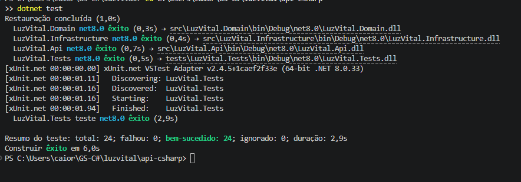
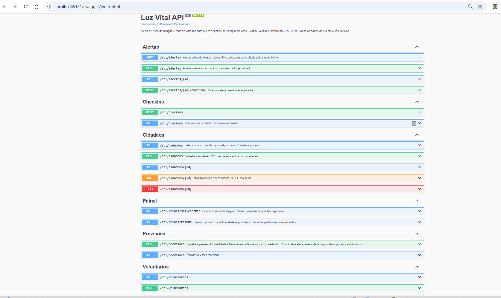
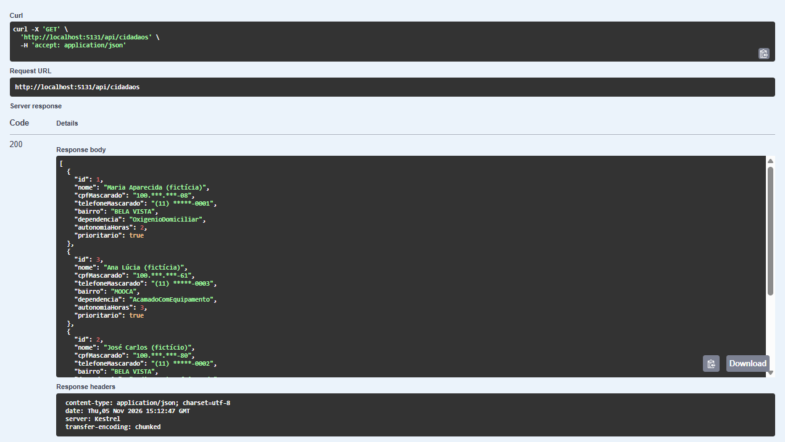
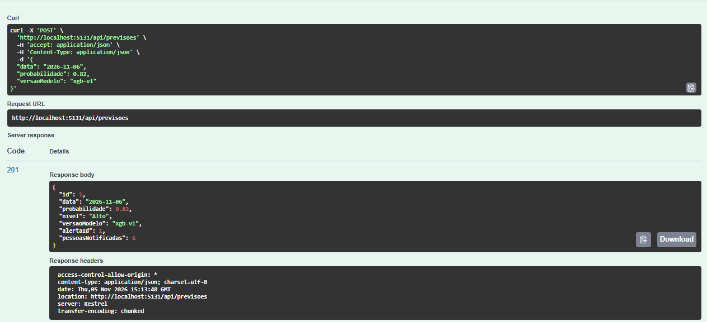
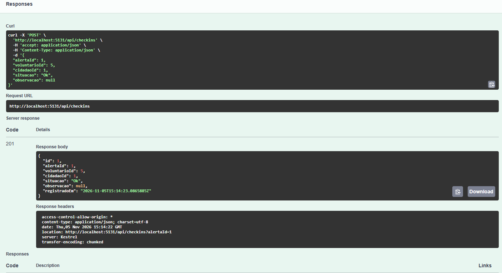
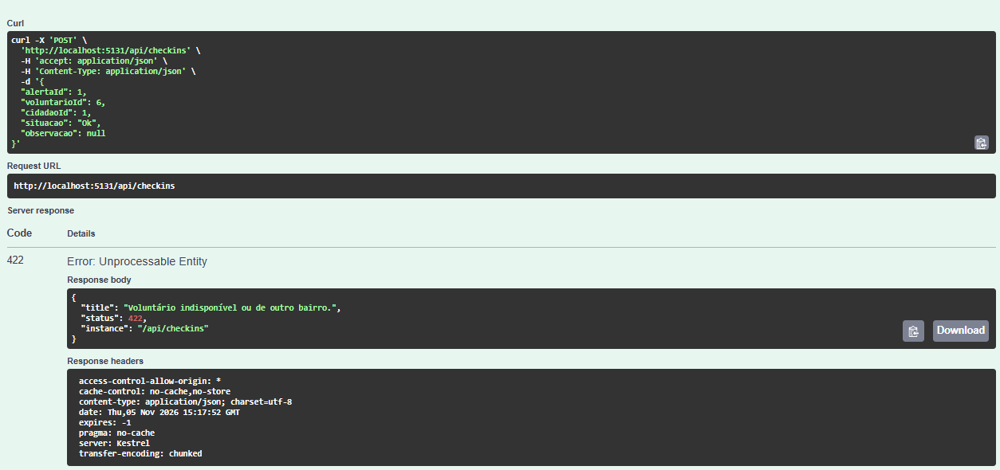
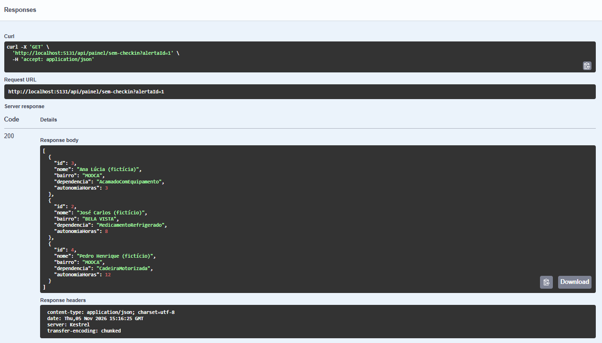
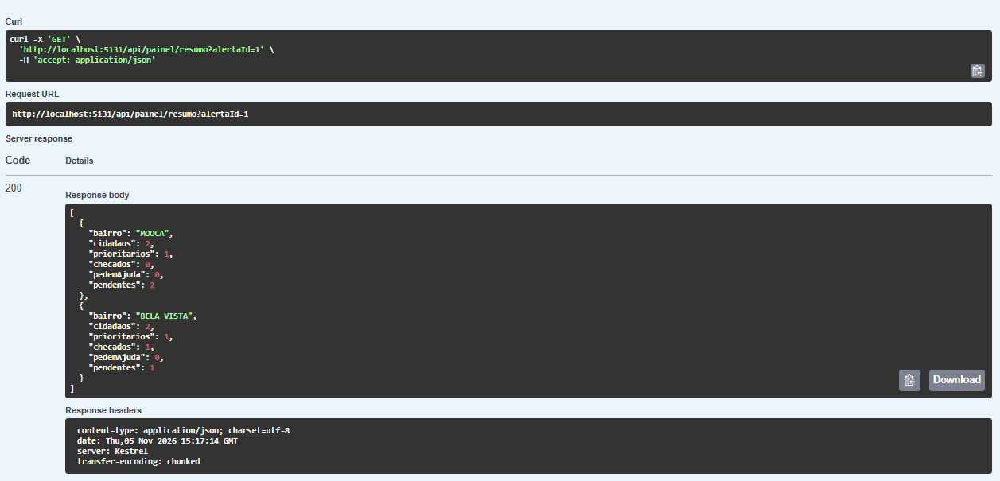

# Luz Vital - API C# (.NET 8)

API central da Luz Vital. Guarda os cidadãos que dependem de energia em casa, os voluntários do bairro, as previsões de risco que chegam do modelo de ML, os alertas e os check-ins feitos durante um apagão.

Os dados de exemplo do seed (`SeedDados.cs`) são fictícios.

## Como rodar

Precisa do [.NET 8 SDK](https://dotnet.microsoft.com/download/dotnet/8.0).

```bash
cd api-csharp
dotnet restore
dotnet run --project src/LuzVital.Api
```

Abra http://localhost:5131/swagger. O banco SQLite (`luzvital.db`) é criado sozinho na primeira execução, já com 4 cidadãos e 2 voluntários fictícios.

Testes:

```bash
dotnet test
```

## Migrations

As migrations (`Inicial` e `Seguranca`) estão em `src/LuzVital.Infrastructure/Migrations/`. A API aplica as migrations com `Migrate()` ao subir.

Para criar uma nova depois de mudar o modelo:

```bash
dotnet tool install --global dotnet-ef
dotnet ef migrations add NomeDaMudanca -p src/LuzVital.Infrastructure -s src/LuzVital.Api
```

## Estrutura

```
src/
  LuzVital.Domain/           entidades e regras de negócio, sem dependência externa
    Entities/                Pessoa (abstrata), Cidadao, Voluntario, PrevisaoRisco, Alerta, CheckIn
    Abstractions/            INotificador, IRelogio
    Cpf.cs, Mascara.cs       validação de CPF e máscaras de dado pessoal
  LuzVital.Infrastructure/   EF Core + SQLite, serviços e notificadores simulados
    Data/                    LuzVitalDbContext (herança TPH), SeedDados
    Servicos/                ServicoAlertas, ServicoPainel (consultas LINQ)
    Notificacao/             SMS e WhatsApp simulados (log com telefone mascarado)
  LuzVital.Api/              controllers, DTOs, tratamento de erros, Swagger
    Seguranca/               motor PII, middlewares, log seguro, fila de eventos e tradutor (IA)
    wwwroot/                 painel-seguranca.html
tests/
  LuzVital.Tests/            xUnit: regras do domínio, serviço de alertas e camada de segurança
```

## Endpoints

| Método | Rota | O que faz |
| --- | --- | --- |
| GET, POST | `/api/cidadaos` | Lista (filtro `?bairro=`) e cadastra cidadão |
| GET, PUT, DELETE | `/api/cidadaos/{id}` | Consulta, atualiza, remove |
| GET, POST | `/api/voluntarios` | Lista e cadastra voluntário |
| PATCH | `/api/voluntarios/{id}/disponibilidade` | Liga/desliga disponibilidade |
| POST | `/api/previsoes` | Entrada do ML. Grava a previsão e, se o risco for 0,4 ou mais, abre alerta e avisa os cidadãos e os voluntários disponíveis |
| GET | `/api/previsoes` | Últimas previsões |
| GET | `/api/alertas?bairro=` | Alertas ativos de hoje em diante (é o que o app mostra) |
| POST | `/api/alertas` | Alerta manual para um bairro |
| POST | `/api/alertas/{id}/encerrar` | Encerra quando a luz volta |
| POST | `/api/checkins` | Voluntário registra que checou alguém |
| GET | `/api/checkins?alertaId=` | Check-ins de um alerta |
| GET | `/api/painel/sem-checkin?alertaId=` | Quem ainda não foi checado, prioritários primeiro |
| GET | `/api/painel/resumo?alertaId=` | Resumo por bairro |
| GET | `/api/seguranca/resumo` | Farol de segurança das últimas 24h e contagens por tipo |
| GET | `/api/seguranca/eventos` | Últimos eventos de segurança, com o aviso para o cidadão |

Exemplos prontos em `src/LuzVital.Api/LuzVital.Api.http`.

### Contrato com o modelo de ML

```http
POST /api/previsoes
{ "data": "2026-11-20", "probabilidade": 0.82, "versaoModelo": "xgb-v1" }
```

| Probabilidade | Nível | Gera alerta? |
| --- | --- | --- |
| menor que 0,4 | Baixo | Não |
| 0,4 a 0,69 | Atencao | Sim |
| 0,7 ou mais | Alto | Sim |

## Regras de negócio

- CPF validado pelos dígitos e único no cadastro
- Cidadão com até 4h de autonomia sem energia é prioritário: recebe o alerta primeiro e aparece no topo do painel
- Previsão não pode ser para data passada; uma segunda previsão para o mesmo dia não duplica o alerta
- Voluntário só faz check-in de quem mora no mesmo bairro, e só se estiver disponível
- Check-in "precisa de ajuda" exige descrição
- Alerta encerrado não aceita check-in

## Dados pessoais

As respostas trazem CPF e telefone mascarados (`529.***.***-25` e `(11) *****-0001`) e não trazem o endereço. Os logs de notificação também usam o telefone mascarado.

## Segurança em tempo real

Uma camada que roda dentro da API (`src/LuzVital.Api/Seguranca/`). A análise estática em `cyber/` continua como auditoria do código.

1. **Dado pessoal na entrada.** O `MotorPii` acha CPF (com dígito válido), RG, telefone, e-mail, endereço, senha ou token (pelo nome do campo), laudo, diagnóstico, CID-10 e os tipos de dependência. Valor que já chega mascarado não conta. Em POST e PUT com JSON, o `MiddlewarePiiEntrada` marca os campos em `HttpContext.Items` e grava no log só o JSON mascarado (`"cpf": "529.***.***-25"`). O controller recebe o corpo sem mudança.
2. **Guarda nas saídas.**
   - Logs: o `ProvedorLogSeguro` embrulha os provedores de log e mascara qualquer dado inteiro antes da escrita.
   - Respostas: o `GuardaRespostas` troca por um 500 ("Resposta bloqueada para proteger dados pessoais") toda resposta JSON com CPF, RG, telefone, e-mail, endereço ou senha inteiros.
   - Exceções: o `TratamentoDeErros` mascara a mensagem antes de responder e de logar.
   - Exceção aceita: o campo `dependencia` pode sair em `/api/cidadaos` e `/api/painel/sem-checkin`. A lista fica em `appsettings.json` (`Seguranca:ExcecoesExposicao`), com o motivo, e é a mesma de `cyber/taint/excecoes.json`.
3. **Eventos e IA.** Cada caso vira um `EventoSeguranca` (tabela da migration `Seguranca`). A descrição técnica guarda só valores mascarados. Os níveis são:
   - verde: entrada mascarada;
   - amarelo: log mascarado;
   - vermelho: resposta bloqueada ou exceção.

   Uma fila em segundo plano manda a descrição mascarada para a API da Anthropic (`ANTHROPIC_API_KEY`, modelo em `Seguranca:ModeloIa`, padrão `claude-haiku-5-5`) e recebe um aviso de 2 frases para o cidadão. Sem chave ou com erro, usa um texto fixo por tipo de evento.
4. **Farol.** `GET /api/seguranca/resumo` dá o pior nível das últimas 24h e as contagens por tipo. `GET /api/seguranca/eventos` traz os últimos eventos. O painel fica em http://localhost:5131/painel-seguranca.html e atualiza a cada 5 segundos.

Em Development há três rotas que vazam dado fictício de propósito, para demonstrar a camada:

- `GET /api/demo-seguranca/log-cpf`: o log sai mascarado;
- `GET /api/demo-seguranca/resposta-cpf`: a resposta é bloqueada com 500;
- `GET /api/demo-seguranca/excecao-endereco`: a exceção é mascarada.

`POST /api/seguranca/limpar` apaga os eventos para recomeçar com o farol verde. As rotas de demonstração e o limpar não existem fora de Development.

## Conceitos aplicados

- POO: `Pessoa` é abstrata, com o método `SaudacaoAlerta()`, e `Cidadao` e `Voluntario` herdam dela; as regras ficam dentro das entidades, com setters privados (`LuzVital.Domain/Entities/`).
- Interfaces: `INotificador` (SMS e WhatsApp simulados), `IRelogio`, `IServicoAlertas` e `IServicoPainel`.
- Injeção de dependência: os serviços e os notificadores são registrados no `Program.cs` e chegam aos controllers pelo construtor.
- EF Core + LINQ: `LuzVitalDbContext` com herança TPH, conversões e índices; as consultas do painel ficam em `ServicoPainel`.
- Async: todo acesso ao banco e todo envio de notificação usam `async`/`await` com `CancellationToken`.
- Testes: xUnit em `tests/LuzVital.Tests`, com as regras do domínio e o `ServicoAlertas` rodando em banco em memória.

## Evidências

1. Testes passando: os 24 testes xUnit de domínio e do serviço de alertas.



2. Swagger: a API no ar com todos os endpoints documentados.



3. CPF e telefone mascarados: a lista de cidadãos não expõe CPF, telefone nem endereço inteiros.



4. Previsão do ML gerando alerta: uma previsão com risco acima de 0,4 abre o alerta.



5. Check-in aceito: um voluntário registra que checou um cidadão do mesmo bairro.



6. Regra de negócio com 422: a API recusa o check-in de um cidadão de outro bairro.



7. Painel: quem ainda falta checar, com os prioritários primeiro.



8. Resumo por bairro: a situação de cada bairro durante o alerta.


