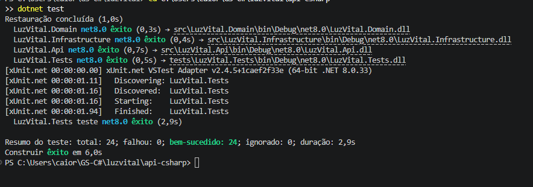
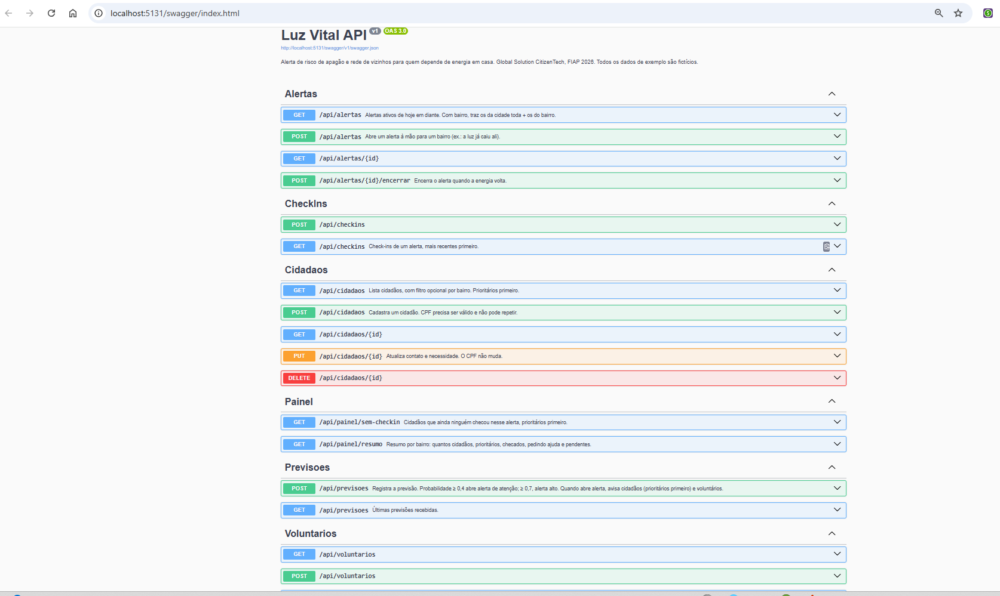
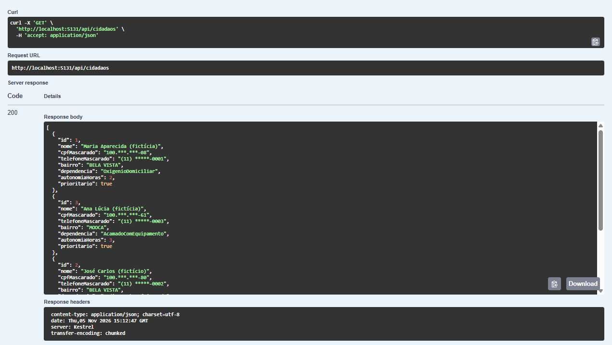
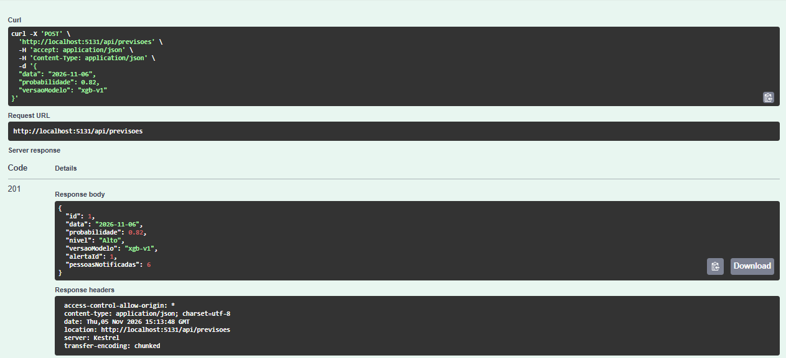
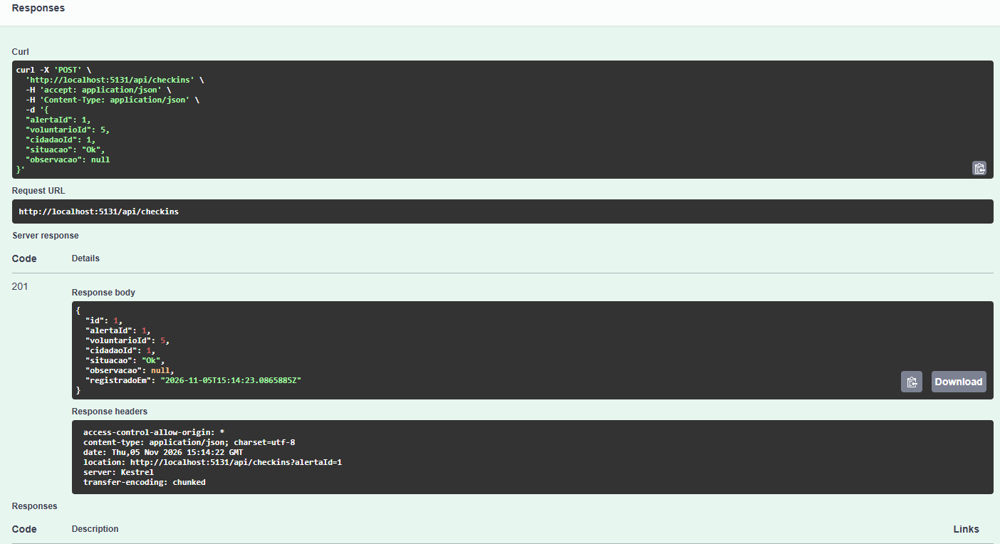
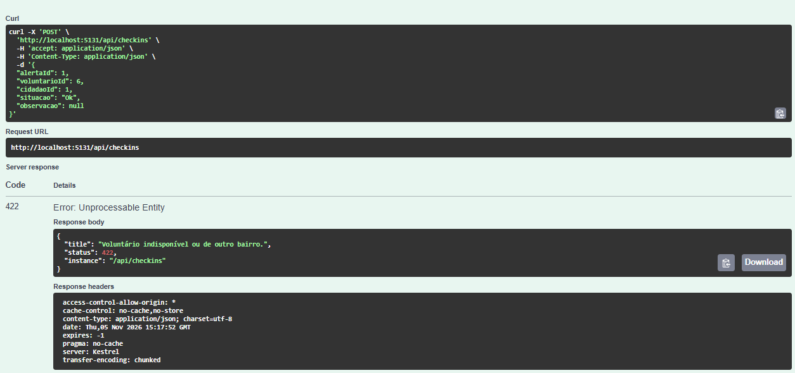
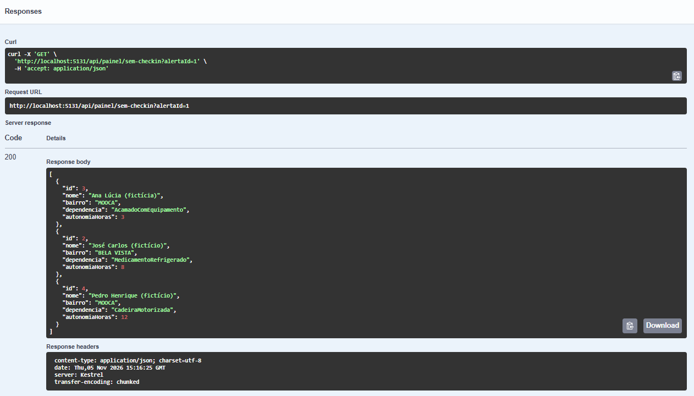
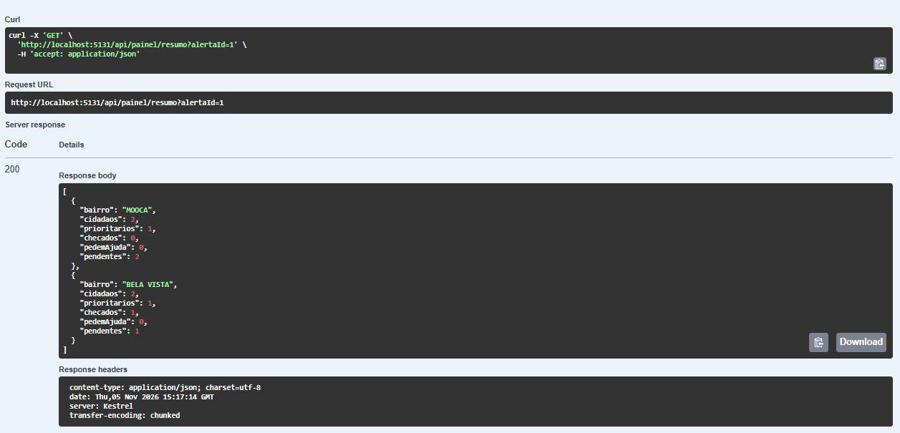

# Luz Vital · API C# (.NET 8)

API central da Luz Vital. Guarda os cidadãos que dependem de energia em casa, os voluntários do bairro, as previsões de risco que chegam do modelo de ML, os alertas e os check-ins feitos durante um apagão.

Todos os dados de exemplo são **fictícios**. Nenhum dado pessoal real é usado.

## Como rodar

Precisa do [.NET 8 SDK](https://dotnet.microsoft.com/download/dotnet/8.0).

```bash
cd api-csharp
dotnet restore
dotnet run --project src/LuzVital.Api
```

Abra http://localhost:5131/swagger. O banco SQLite (`luzvital.db`) é criado sozinho na primeira execução, já com 4 cidadãos e 2 voluntários fictícios.

Testes:

```bash
dotnet test
```

## Migrations

O projeto sobe sem migration (usa `EnsureCreated`). Para gerar a migration inicial, que é o que a disciplina pede:

```bash
dotnet tool install --global dotnet-ef
rm -f src/LuzVital.Api/luzvital.db
dotnet ef migrations add Inicial -p src/LuzVital.Infrastructure -s src/LuzVital.Api
dotnet run --project src/LuzVital.Api
```

Depois que existe migration, a API aplica com `Migrate()` ao subir.

## Estrutura

```
src/
  LuzVital.Domain/           entidades e regras de negócio, sem dependência externa
    Entities/                Pessoa (abstrata), Cidadao, Voluntario, PrevisaoRisco, Alerta, CheckIn
    Abstractions/            INotificador, IRelogio
    Cpf.cs, Mascara.cs       validação de CPF e máscaras de dado pessoal
  LuzVital.Infrastructure/   EF Core + SQLite, serviços e notificadores simulados
    Data/                    LuzVitalDbContext (herança TPH), SeedDados
    Servicos/                ServicoAlertas, ServicoPainel (consultas LINQ)
    Notificacao/             SMS e WhatsApp simulados (log com telefone mascarado)
  LuzVital.Api/              controllers, DTOs, tratamento de erros, Swagger
tests/
  LuzVital.Tests/            xUnit: regras do domínio + serviço de alertas com banco em memória
```

## Endpoints

| Método | Rota | O que faz |
| --- | --- | --- |
| GET, POST | `/api/cidadaos` | Lista (filtro `?bairro=`) e cadastra cidadão |
| GET, PUT, DELETE | `/api/cidadaos/{id}` | Consulta, atualiza, remove |
| GET, POST | `/api/voluntarios` | Lista e cadastra voluntário |
| PATCH | `/api/voluntarios/{id}/disponibilidade` | Liga/desliga disponibilidade |
| POST | `/api/previsoes` | **Entrada do ML.** Grava a previsão e, se o risco for ≥ 0,4, abre alerta e avisa todo mundo |
| GET | `/api/previsoes` | Últimas previsões |
| GET | `/api/alertas?bairro=` | Alertas ativos de hoje em diante (é o que o app mostra) |
| POST | `/api/alertas` | Alerta manual para um bairro |
| POST | `/api/alertas/{id}/encerrar` | Encerra quando a luz volta |
| POST | `/api/checkins` | Voluntário registra que checou alguém |
| GET | `/api/checkins?alertaId=` | Check-ins de um alerta |
| GET | `/api/painel/sem-checkin?alertaId=` | Quem ainda não foi checado, prioritários primeiro |
| GET | `/api/painel/resumo?alertaId=` | Resumo por bairro |

Exemplos prontos em `src/LuzVital.Api/LuzVital.Api.http`.

### Contrato com o modelo de ML

```http
POST /api/previsoes
{ "data": "2026-11-20", "probabilidade": 0.82, "versaoModelo": "xgb-v1" }
```

| Probabilidade | Nível | Gera alerta? |
| --- | --- | --- |
| < 0,4 | Baixo | Não |
| 0,4 a 0,69 | Atencao | Sim |
| ≥ 0,7 | Alto | Sim |

## Regras de negócio

- CPF validado pelos dígitos e único no cadastro
- Cidadão com até 4h de autonomia sem energia é **prioritário**: recebe o alerta primeiro e aparece no topo do painel
- Previsão não pode ser para data passada; uma segunda previsão para o mesmo dia não duplica o alerta
- Voluntário só faz check-in de quem mora no mesmo bairro, e só se estiver disponível
- Check-in "precisa de ajuda" exige descrição
- Alerta encerrado não aceita check-in

## Dados pessoais

CPF e telefone nunca saem inteiros: as respostas trazem `529.***.***-25` e `(11) *****-0001`, e o endereço não sai em nenhuma resposta. Os logs de notificação também usam o telefone mascarado.

## Como cobre a rubrica

| Critério | Onde |
| --- | --- |
| POO (3,0) | Herança `Pessoa` → `Cidadao`/`Voluntario` com método abstrato; encapsulamento (setters privados, regras dentro das entidades); interface `INotificador` com duas implementações |
| Web API (2,5) | 6 controllers REST, DTOs, códigos HTTP certos (201, 204, 404, 409, 422), validação, `ProblemDetails` |
| EF Core + LINQ (1,5) | `DbContext` com TPH, conversões, índices; consultas em `ServicoPainel` |
| Async/await (1,0) | Todo acesso a banco e envio de notificação é assíncrono, com `CancellationToken` |
| Qualidade (2,0) | Camadas separadas, injeção de dependência, tratamento central de erros, testes xUnit |

## Evidências

**1. Testes passando:** os 24 testes xUnit de domínio e do serviço de alertas.



**2. Swagger:** a API no ar com todos os endpoints documentados.



**3. CPF e telefone mascarados:** a lista de cidadãos não expõe CPF, telefone nem endereço inteiros.



**4. Previsão do ML gerando alerta:** uma previsão com risco acima de 0,4 abre o alerta.



**5. Check-in aceito:** um voluntário registra que checou um cidadão do mesmo bairro.



**6. Regra de negócio com 422:** a API recusa o check-in de um cidadão de outro bairro.



**7. Painel:** quem ainda falta checar, com os prioritários primeiro.



**8. Resumo por bairro:** a situação de cada bairro durante o alerta.


